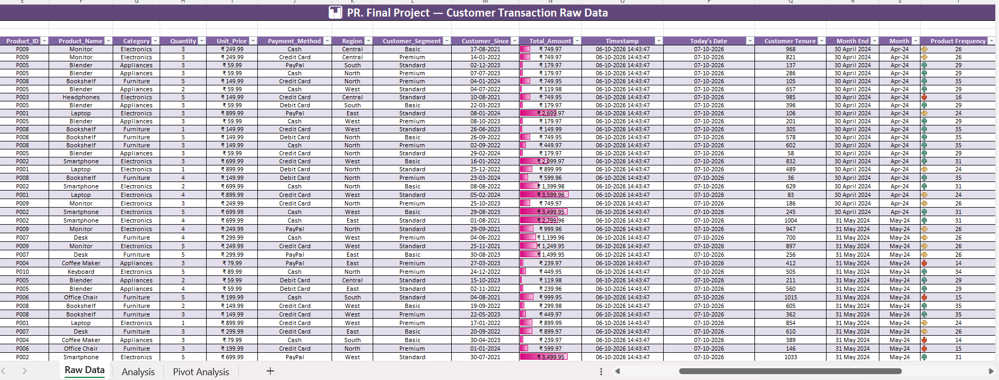
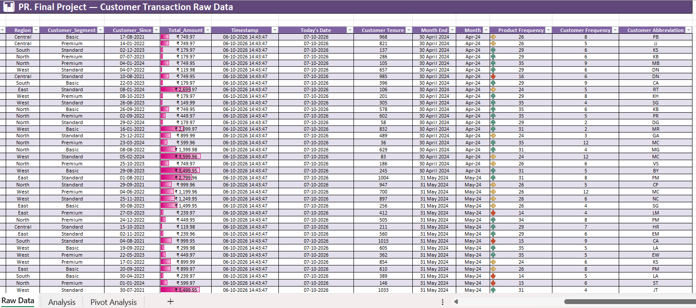
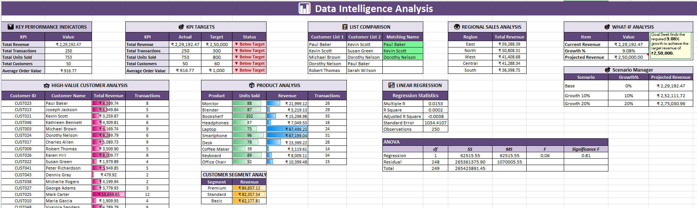
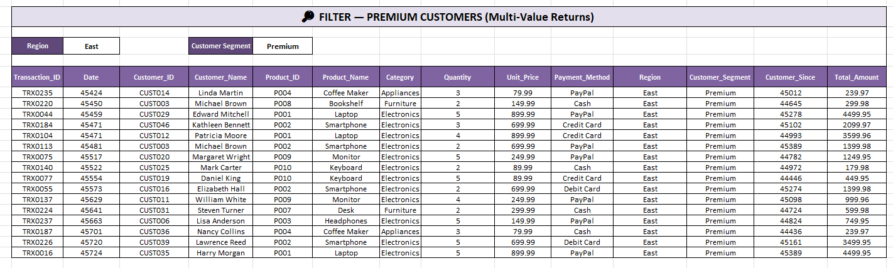
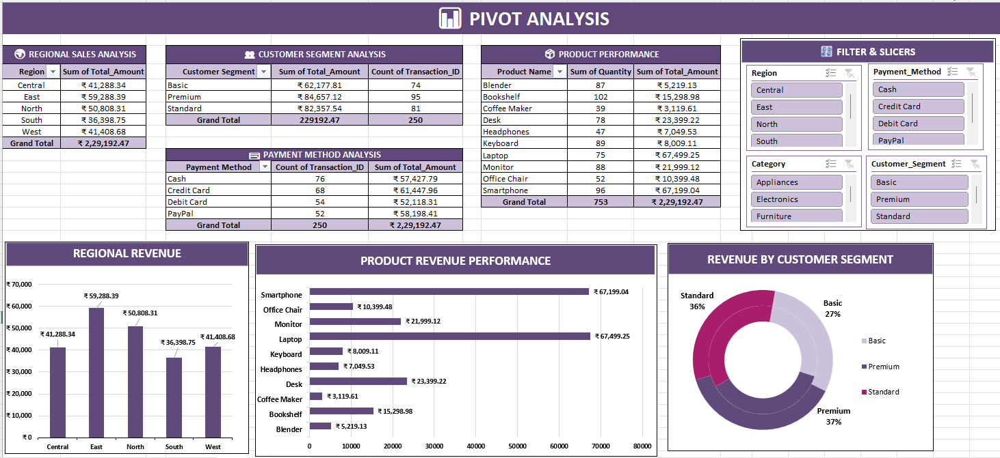
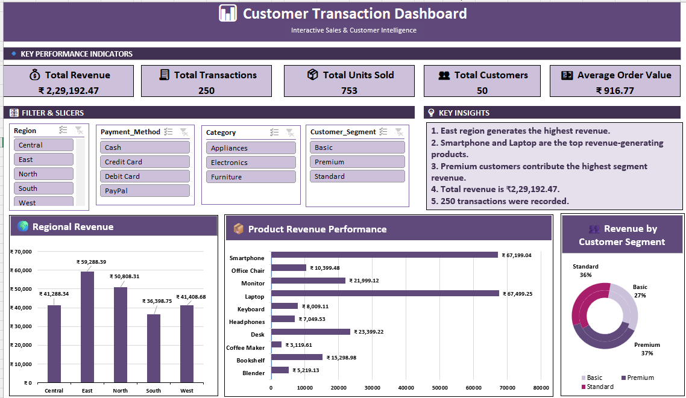

# 📊 Customer Transaction Intelligence — Excel Analytics Project

## 📌 Project Overview

An end-to-end **Excel Data Analytics project** built to analyze customer transactions and answer practical business questions around **revenue, customers, products, regions, payment methods, and sales performance**.

The project transforms raw transaction data into structured analysis, statistical insights, interactive PivotTables, slicers, and a business-focused dashboard.

---

## 🎯 Business Questions Answered

This project focuses on questions such as:

- Which region generates the highest revenue?
- Which products contribute the most to overall sales?
- Which customer segment is the most valuable?
- Who are the highest-value customers?
- Which payment methods generate the most revenue and transactions?
- Are sales and customer KPIs meeting their targets?
- How much revenue growth is required to achieve a target?
- What would revenue look like under different growth scenarios?
- Is customer tenure strongly related to transaction value?
- Can management interactively analyze performance by region, category, segment, and payment method?

---

## 🛠️ Tools & Skills Used

**Microsoft Excel**

- Data Cleaning & Preparation
- Excel Formulas & Dynamic Arrays
- KPI Analysis
- Conditional Formatting
- PivotTables & PivotCharts
- Interactive Slicers
- What-If Analysis
- Scenario Manager
- Goal Seek
- Linear Regression & ANOVA
- Data Visualization
- Business Insight Generation

### Key Functions

`SUM` · `SUMIF` · `COUNTIF` · `COUNTA` · `AVERAGE` · `UNIQUE` · `XLOOKUP` · `FILTER` · `DATEDIF` · `EOMONTH` · `TEXT` · `TODAY` · `NOW`

---

# 📂 Project Analysis

## 1. 🗃️ Raw Transaction Data

### Business Purpose

The project starts with **250 customer transactions** containing customer, product, sales, payment, regional, and segment information.

This dataset provides the foundation for answering questions such as:

- Who are the customers?
- What products are being purchased?
- How much revenue is generated?
- Which regions and customer segments are involved?
- How are customers paying?

---

## 2. ⚙️ Data Preparation & Feature Engineering

### Business Purpose

Additional analytical fields were created to make the raw data more useful for decision-making.

These include **customer tenure, month-end dates, month labels, product frequency, customer frequency, and customer abbreviations**.

This helps answer questions such as:

- How long have customers been associated with the business?
- How frequently are products purchased?
- How frequently do customers transact?
- How can transactions be grouped into meaningful time periods?

---

# 3. 📈 Data Intelligence Analysis

### Business Questions Answered

This analysis evaluates overall business performance and customer/product contribution.

**Performance & Targets**
- Is the business meeting its revenue, transaction, unit, customer, and order-value targets?
- Where are the biggest performance gaps?

**Customer Analysis**
- Which customers generate the most revenue?
- Which customers have the highest transaction activity?
- Which customers should be considered high-value customers?

**Product Analysis**
- Which products sell the most units?
- Which products generate the most revenue?
- Are high-volume products also high-revenue products?

**Regional Analysis**
- Which regions are driving revenue?
- Which regions may require additional attention?

**Customer Segments**
- Which customer segment contributes the most revenue?
- Which segment has the highest transaction volume?

**List Comparison**
- Which customers appear in both customer lists?

---

# 4. 🔎 Dynamic Customer Filtering

### Business Question Answered

**Which transactions come from Premium customers in a selected region?**

The dynamic `FILTER` analysis allows users to retrieve matching transaction records based on multiple conditions.

For example, the analysis can isolate **Premium customers from the East region**, helping management investigate the transactions and purchasing behavior of a specific customer group.

---

# 5. 📊 Pivot Analysis

### Business Questions Answered

PivotTables provide a summarized view of the business from multiple perspectives:

**Regional Performance**
- Which regions generate the highest and lowest revenue?

**Customer Segments**
- Which segment contributes the most revenue?
- How many transactions come from each segment?

**Product Performance**
- Which products have the highest sales volume?
- Which products generate the highest revenue?

**Payment Methods**
- Which payment method is used most frequently?
- Which payment method contributes the most revenue?

These summaries make it easier to compare performance and identify areas requiring business attention.

---

# 6. 🎛️ Interactive Customer Transaction Dashboard

### Business Purpose

The dashboard brings the major findings into a single interactive business view.

It allows users to answer questions quickly without manually reviewing the raw dataset.

### Key Questions

- What is the current total revenue?
- How many transactions and units were sold?
- How many customers are represented?
- Which region is performing best?
- Which products generate the most revenue?
- Which customer segment contributes the most revenue?
- How does performance change when filtering by region, category, payment method, or customer segment?

The dashboard uses **interactive slicers** so users can explore different business scenarios dynamically.

---

# 💡 Key Business Insights

Based on the current dataset:

### 🌍 Regional Performance
**East** is the highest-revenue region with approximately **₹59.29K**, while **South** generates the lowest revenue at approximately **₹36.40K**.

### 📦 Product Performance
**Laptop** and **Smartphone** are the strongest revenue-generating products, contributing approximately **₹67.50K** and **₹67.20K** respectively.

### 👥 Customer Segments
The **Premium segment** generates the highest revenue at approximately **₹84.66K**, followed by Standard and Basic customers.

### 💰 Overall Performance
The dataset generates approximately **₹2.29 lakh revenue** across **250 transactions**, with **753 units sold** and **50 customers**.

### 🎯 Target Performance
Current revenue is approximately **₹229.19K** against a **₹250K target**. Goal Seek indicates that approximately **9.08% growth** is required to reach the target.

### 📈 Scenario Planning
Under the Scenario Manager:
- **0% growth:** ₹229.19K
- **10% growth:** ₹252.11K
- **20% growth:** ₹275.03K

This provides a simple framework for evaluating potential revenue outcomes under different growth assumptions.

### 📊 Statistical Finding
The regression analysis shows a **very weak relationship between customer tenure and transaction amount** (`R² ≈ 0.0002`). This suggests that customer tenure alone does not meaningfully explain transaction value in this dataset.

---

# 💼 Business Value

This project demonstrates how raw transaction data can be converted into **decision-ready business intelligence**.

The analysis can help management:

- Identify high-performing regions
- Focus on high-value customers
- Prioritize high-revenue products
- Understand customer segments
- Evaluate payment behavior
- Monitor KPI performance
- Test revenue growth scenarios
- Explore data interactively through slicers and dashboards

---

# 📌 Final Takeaway

The project demonstrates an end-to-end **Excel analytics workflow** — from raw data preparation and feature engineering to business analysis, statistical evaluation, PivotTables, interactive filtering, scenario planning, and dashboard storytelling.

It showcases practical skills relevant to **Data Analyst, Business Analyst, and Reporting Analyst** roles.
